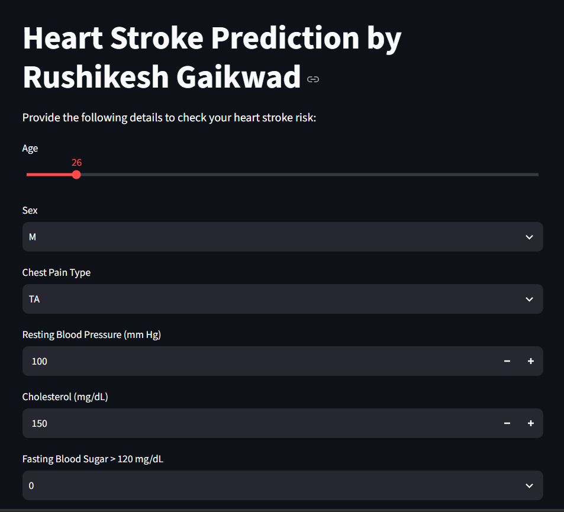
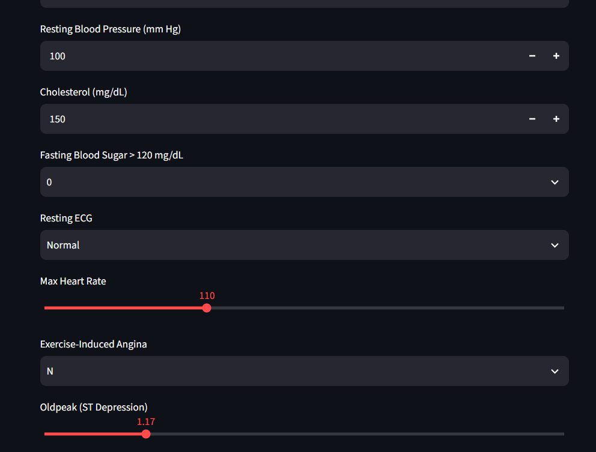
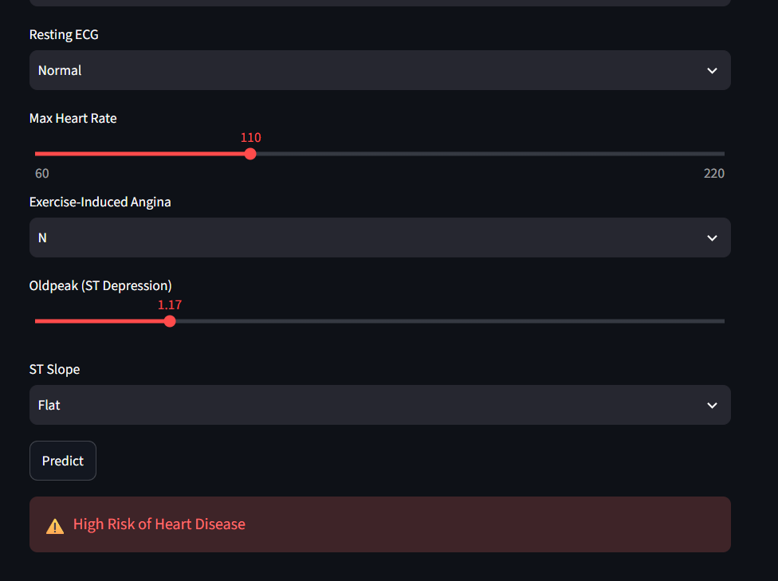

# ❤️ Heart Disease Prediction Using Machine Learning

A Machine Learning web application built with **Python, Scikit-learn, Pandas, and Streamlit** to predict the potential risk of heart disease based on user-provided health parameters.

The application uses a trained **K-Nearest Neighbors (KNN)** model to analyze the entered health information and display a prediction through an interactive web interface.

## 📸 Project UI Screenshots

### 1. Home Page

The home page introduces the application and allows users to enter their health-related information.



### 2. Enter Health Parameters

Users can provide details such as age, sex, chest pain type, resting blood pressure, cholesterol, fasting blood sugar, resting ECG, maximum heart rate, exercise-induced angina, oldpeak, and ST slope.



### 3. Prediction Result

After clicking the **Predict** button, the application processes the entered data and displays the model's prediction.




## 🚀 Features

- Interactive web interface built with Streamlit.
- User input for 11 health-related parameters.
- Pre-trained KNN classification model.
- Data preprocessing and feature scaling.
- Automatic one-hot encoded feature alignment.
- Instant prediction on clicking the Predict button.
- Clear visual output for predicted high-risk and low-risk categories.

## 🛠️ Technologies Used

| Technology | Purpose |
|---|---|
| Python | Core programming language |
| Streamlit | Interactive web application |
| Pandas | Data handling and input preparation |
| Scikit-learn | Machine learning model and feature scaling |
| Joblib | Loading saved model and preprocessing files |
| K-Nearest Neighbors (KNN) | Classification algorithm |

## ⚙️ How the Project Works

The application follows these steps:

1. **User Input:** The user enters health information using sliders, dropdowns, and number inputs.
2. **Data Preparation:** The application converts the entered information into a Pandas DataFrame.
3. **Feature Encoding:** Categorical variables are represented using the same one-hot encoded feature structure expected by the trained model.
4. **Column Alignment:** Missing expected features are filled with zeros, and columns are arranged in the correct order.
5. **Feature Scaling:** The saved scaler transforms the input data into the format expected by the model.
6. **Prediction:** The trained KNN model classifies the input.
7. **Result Display:** Streamlit displays the prediction using a success or warning message.

## 📂 Project Structure

```text
heart-disease-prediction/
│
├── app.py
├── KNN_heart.pkl
├── scaler.pkl
├── columns.pkl
├── requirements.txt
├── README.md
│
└── screenshots/
    ├── home-page.png
    ├── input-form.png
    └── prediction-result.png
```

**File descriptions:**

- `app.py` — Main Streamlit application.
- `KNN_heart.pkl` — Saved, trained KNN model.
- `scaler.pkl` — Saved feature scaler used during training.
- `columns.pkl` — Expected feature columns and their order.
- `requirements.txt` — Python package dependencies.
- `screenshots/` — Images of the application's user interface.

## 💻 Installation and Setup

### Prerequisites

- Python 3.10 or a compatible Python version.
- Git.
- Visual Studio Code or another Python editor.

### Step 1: Clone the Repository

```bash
git clone https://github.com/YOUR-USERNAME/heart-disease-prediction.git
```

Navigate to the project directory:

```bash
cd heart-disease-prediction
```

### Step 2: Create a Virtual Environment

```bash
python -m venv venv
```

Activate it on Windows:

```powershell
.\venv\Scripts\Activate.ps1
```

If you use Command Prompt instead:

```cmd
venv\Scripts\activate
```

### Step 3: Install Dependencies

Create a `requirements.txt` file with the required packages:

```text
streamlit
pandas
scikit-learn
joblib
```

Install them:

```bash
pip install -r requirements.txt
```

**Important:** Use the same compatible Scikit-learn version as the one used to train and save your model and scaler, where possible.

### Step 4: Run the Application

Make sure `app.py` and all three saved `.pkl` files are in the project directory.

Run:

```bash
streamlit run app.py
```

Streamlit will provide a local URL, usually:

```text
http://localhost:8501
```

Open that address in your browser to use the application.

## 🧠 Machine Learning Model

**Algorithm:** K-Nearest Neighbors (KNN)

The application loads a previously trained KNN model rather than training a new model each time the application starts.

The model receives scaled input features and returns a classification:

- **Class 1:** Displayed as “High Risk of Heart Disease.”
- **Class 0:** Displayed as “Low Risk of Heart Disease.”

The actual model performance depends on the training dataset, preprocessing, and evaluation results. Accuracy, precision, recall, and F1-score should be added here only after measuring them on an appropriate test dataset.

## 🔮 Future Improvements

- Add model evaluation metrics and a confusion matrix.
- Improve input validation and error handling.
- Add model comparison with Logistic Regression, Random Forest, and other classifiers.
- Deploy the application so users can access it online.
- Improve the user interface and add informative visualizations.
- Evaluate the model on representative, independent test data.

## ⚠️ Disclaimer

This project is intended for educational and demonstration purposes only. Its predictions are not a medical diagnosis and should not be used to make medical decisions. Consult a qualified healthcare professional for medical assessment.

## 👨‍💻 Author

**Rushikesh Gaikwad**

- GitHub: [rushigaikwad2664](https://github.com/rushigaikwad2664)
- LinkedIn: [Rushikesh Gaikwad](https://www.linkedin.com/in/rushikesh-gaikwad-3a6925245)

---

⭐ If you find this project useful, consider giving the repository a star!
